# Rating 42 — Peer Rating System

A web application for **42 Amman** where students rate the peers they work with
(on a 1–3 star scale with flags and written feedback), and staff moderate those
ratings. The system weights every rating by the voter's credibility and
automatically detects suspicious voting patterns (group voting, retaliation,
closed cliques, and more) so that staff can review them.

---
## Screenshots & Preview

<details>
<summary>📸 <b>Click to expand all app screenshots</b></summary>

### Authentication
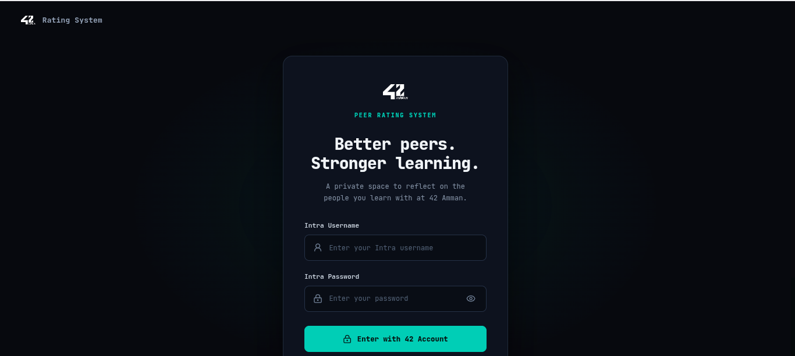
*Login interface for students and staff with JWT credentials.*

---

### Student Experience

#### Dashboard & Progress
<p align="center">
  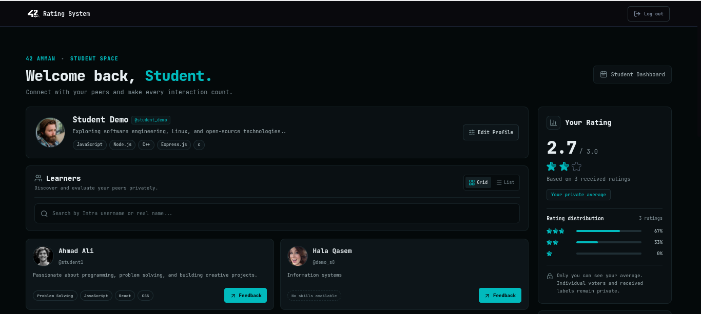
  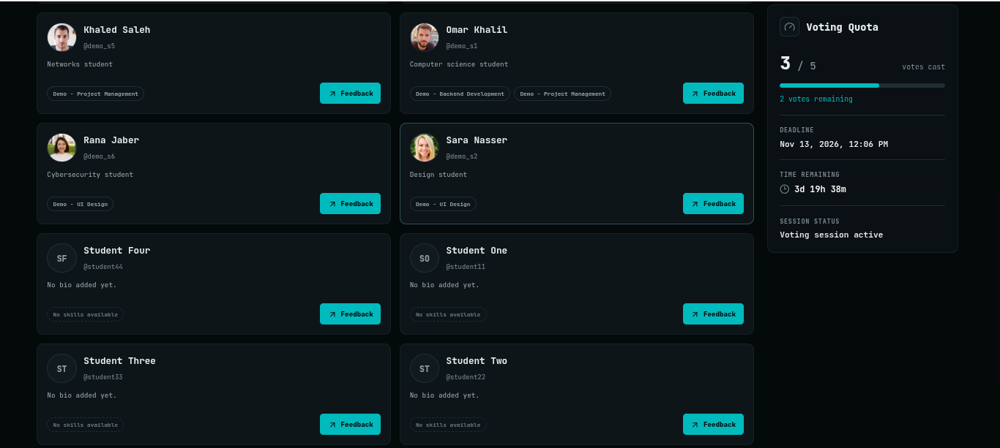
</p>

* **Left:** Active voting window overview with peer search grid and rating action buttons.
* **Right:** Personal stats panel showing total votes cast, remaining votes, average rating, and star breakdown.

#### Peer Rating Flow
<p align="center">
  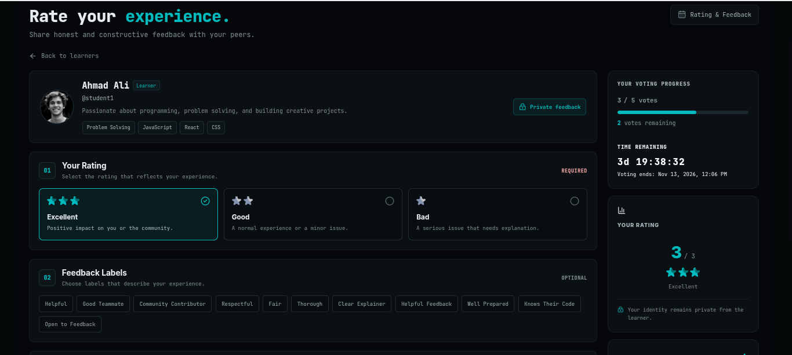
  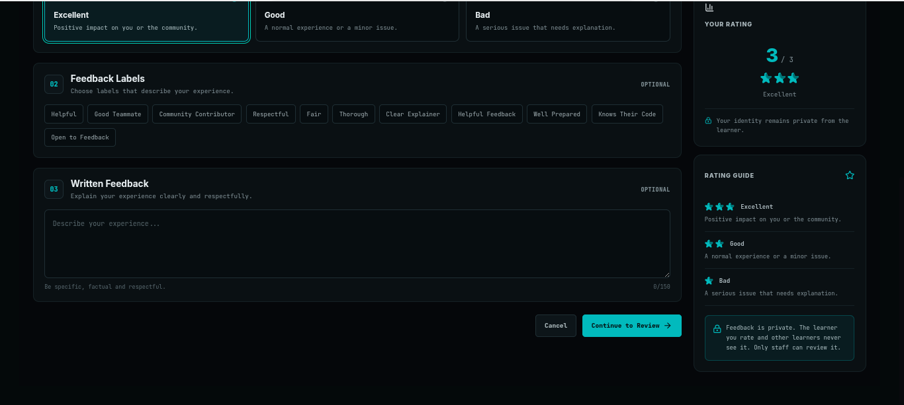
</p>

* **Left:** Interactive star rating selection (1-3 stars) alongside flag/label assignments.
* **Right:** Written feedback confirmation step (mandatory for 1-star ratings) prior to final submission.

---

### Staff Management & Moderation

#### System Overview & Analytics
<p align="center">
  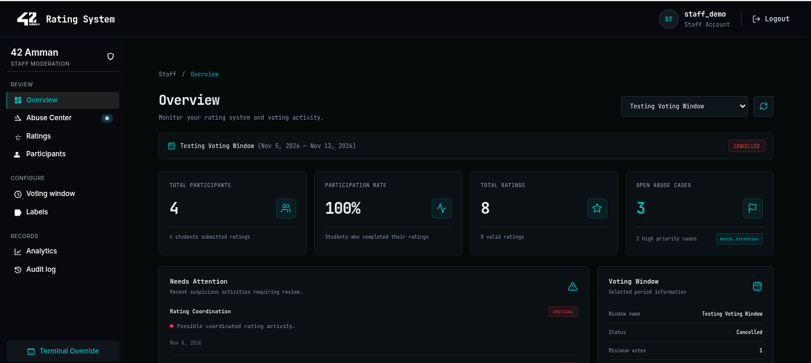
  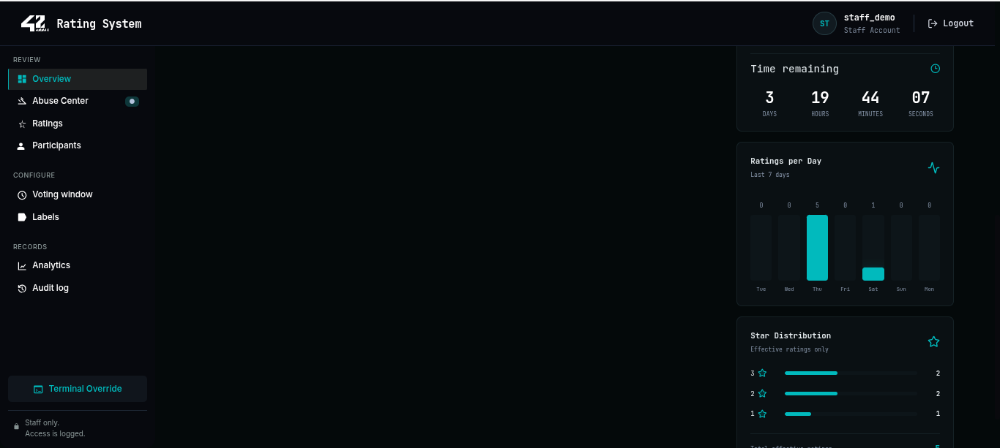
</p>

* Overview metrics displaying active windows, overall completion rates, total ratings, and open flags.

<p align="center">
  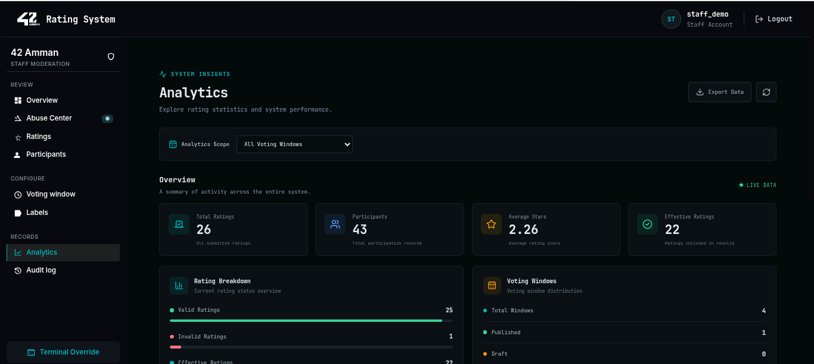
  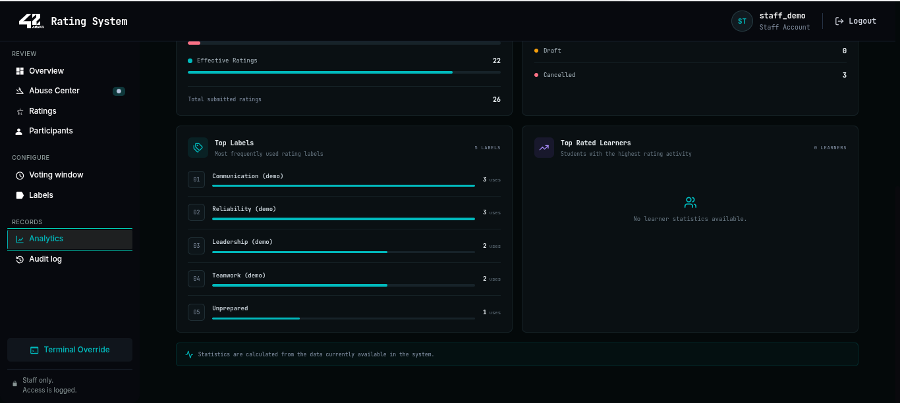
</p>

* Deep dive into rating distributions, daily engagement trends, and exportable JSON/CSV analytics.

#### Voting Windows & Participation
<p align="center">
  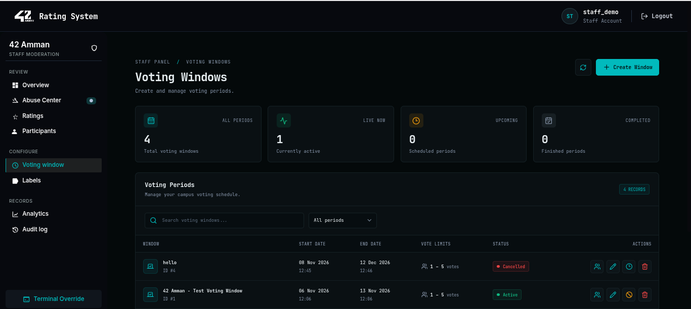
  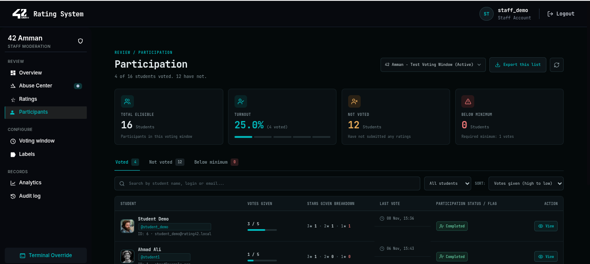
</p>

* Management panel to create, publish, or modify voting windows, alongside per-user participation status tracking (`staff_Participation2.png`).

#### Abuse Center (Suspicious Activity Detection)
<p align="center">
  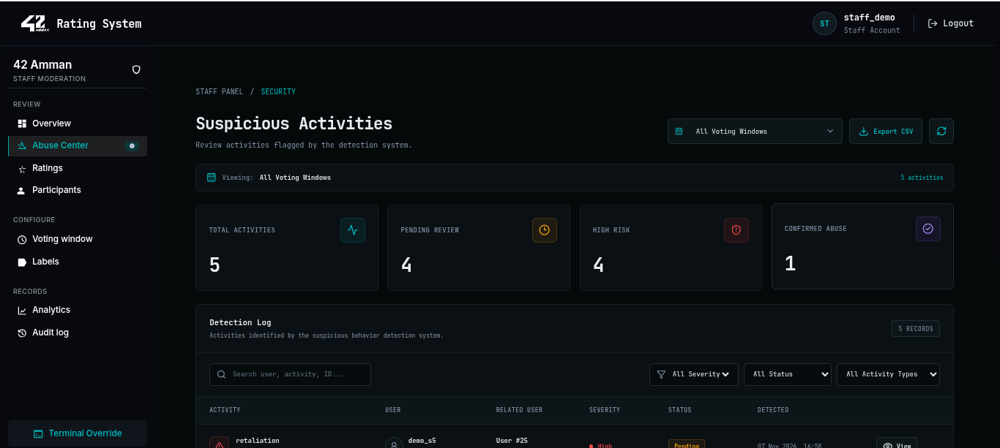
  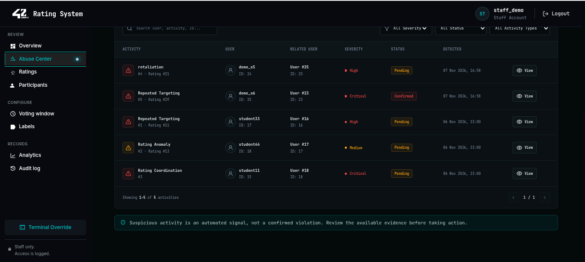
</p>

* Automated detection grid flagging suspicious voting patterns (group voting, retaliatory rates, closed cliques) with severity filters and review controls.

#### Ratings Management, Labels & Audit Logs
<p align="center">
  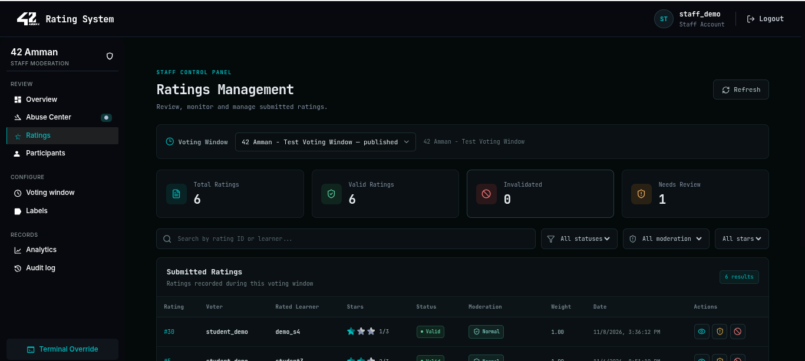
  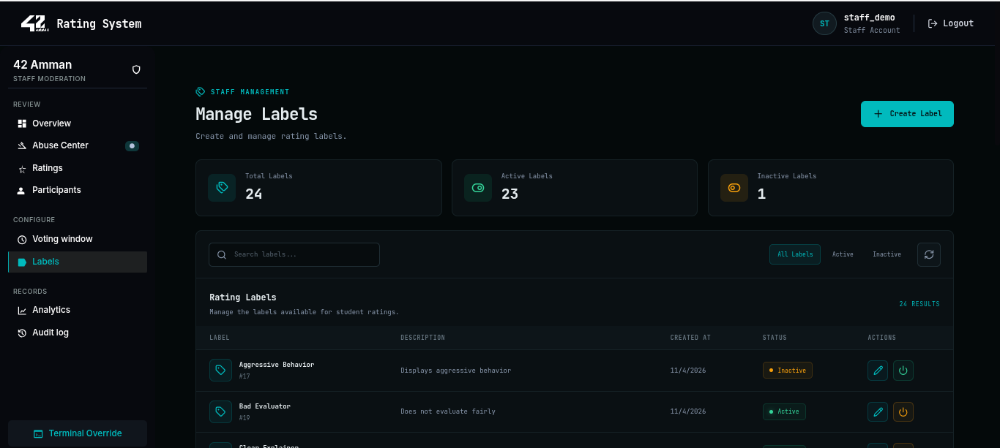
</p>

* **Left:** Ratings moderation view to filter, invalidate, or adjust score statuses (`staff_RatingsManagement2.png`).
* **Right:** Flag/label catalog management linked to star rating requirements.

<p align="center">
  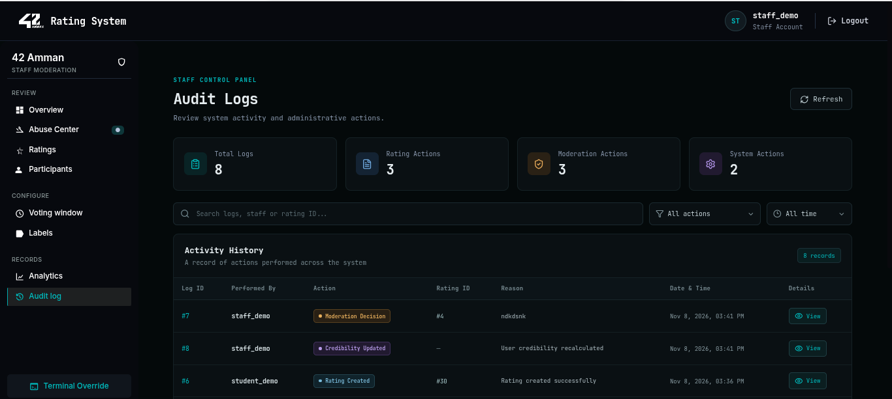
  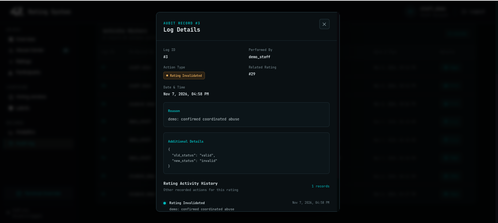
</p>

* Detailed system action log tracking before-and-after states for moderation actions.

</details>

## Features

**Students**
- Secure login (JWT in httpOnly cookies, automatic token refresh)
- Dashboard with the active voting window, live countdown, and a searchable
  grid/list of learners they can still rate
- Personal statistics: votes cast, votes remaining, average rating received, and
  star distribution (individual ratings stay anonymous)
- Rating flow: choose Excellent / Good / Bad → pick flags → optional feedback
  (required for 1 star) → final review → submit
- Edit profile: bio and skills

**Staff**
- Overview dashboard (participation rate, total ratings, open abuse cases,
  ratings per day, star distribution)
- Voting windows: create, edit, publish, cancel, delete, and manage participants
- Participation tracking per window (not voted / below minimum / completed)
- Ratings management: filter, invalidate a rating, or change its moderation status
- Labels (flags) management
- Abuse Center: automatically detected suspicious activities with severity levels
- Analytics: system-wide and per-window, with JSON export
- Audit log: every important action is recorded with before/after details

---

## Tech Stack

| Layer    | Technology |
|----------|------------|
| Frontend | React 19, Vite, React Router 7, Axios, react-hot-toast, lucide-react |
| Backend  | Node.js, Express 5, mysql2, bcrypt, jsonwebtoken, cookie-parser, cors, dotenv |
| Database | MariaDB (MySQL-compatible) |

---

## Project Structure

```
rating42-project/
├── backend/
│   ├── config/         # Database connection pool
│   ├── controllers/    # Request validation and responses
│   ├── middleware/     # verifyToken, verifyStaff
│   ├── routes/         # Express routers (/api/...)
│   ├── services/       # Business logic and algorithms
│   ├── utils/          # JWT helpers
│   └── server.js
├── frontend/
│   └── src/
│       ├── pages/      # auth, student, staff
│       ├── layouts/    # StudentLayout, StaffLayout
│       ├── components/ # Sidebar, Navbars, Loader
│       ├── contexts/   # AuthContext, LoadingContext
│       ├── services/   # Axios instance and API helpers
│       └── routes/     # AppRoutes, ProtectedRoute
└── database/
    └── rating_system.sql   # Schema + relationships + sample data
```

---

## Prerequisites

Install these first:

| Tool | Version | Check with |
|------|---------|-----------|
| [Node.js](https://nodejs.org) | 20.19+ (or 22+) | `node -v` |
| npm | comes with Node | `npm -v` |
| [MariaDB](https://mariadb.org/download/) | 10.5+ (needed for `JSON_ARRAYAGG`) | `mariadb --version` |
| Git | any recent version | `git --version` |

---

## Getting Started

### 1. Clone the repository

```bash
git clone <YOUR_REPOSITORY_URL>
cd rating42-project
```

### 2. Set up the database

Make sure MariaDB is running, then import the dump. It creates the
`rating_system` database automatically (tables, foreign keys, and sample data):

```bash
mysql -u root -p < database/rating_system.sql
```

Verify it worked:

```bash
mysql -u root -p -e "USE rating_system; SHOW TABLES; SELECT COUNT(*) AS users FROM users;"
```

You should see 12 tables.

### 3. Configure and start the backend

```bash
cd backend
npm install
```

Create a file named `.env` inside `backend/`:

```env
PORT=5000

DB_HOST=localhost
DB_USER=root
DB_PASSWORD=your_mariadb_password
DB_NAME=rating_system

ACCESS_TOKEN_SECRET=put_a_long_random_string_here
REFRESH_TOKEN_SECRET=put_another_long_random_string_here
```

Generate strong secrets with:

```bash
node -e "console.log(require('crypto').randomBytes(64).toString('hex'))"
```

Run it twice and use one value for each secret.

Start the server:

```bash
npx nodemon server.js     # auto-restarts on changes (development)
# or
node server.js
```

You should see `Server running on port 5000`.

### 4. Start the frontend

Open a **second terminal**:

```bash
cd frontend
npm install
npm run dev
```

Open **http://localhost:5173** in your browser.

> The frontend talks to `http://localhost:5000/api` by default. To change it,
> create `frontend/.env` with `VITE_API_URL=http://localhost:5000/api`.

---

## Logging In

The database stores passwords as **bcrypt hashes**, and there is no
registration page. Some users in the sample data have no password set, and the
passwords of the others are not documented, so **set a password for the
accounts you want to use**.

See the users and whether they can log in:

```bash
mysql -u root -p -e "SELECT user_id, username, role, password_hash IS NOT NULL AS has_password FROM rating_system.users;"
```

Set a password (run from the `backend/` folder; the last two values are the
new password and the username):

```bash
node -e "require('dotenv/config');const bcrypt=require('bcrypt');const db=require('./config/db');(async()=>{const hash=await bcrypt.hash(process.argv[1],10);const [r]=await db.query('UPDATE users SET password_hash=? WHERE username=?',[hash,process.argv[2]]);console.log('Updated rows:',r.affectedRows);process.exit(0)})()" "NewPassword123" staff1
```

Do the same for a student account, for example `student1`. `Updated rows: 1`
means it worked. Then log in with the **username** and the new password.

| Role    | What they can do |
|---------|------------------|
| student | Dashboard, rate peers, edit profile |
| staff   | Everything under `/staff`: windows, ratings, labels, abuse center, analytics, audit log |

---

## Using the Sample Data

- The sample data includes a published voting window named
  **"42 Amman - Test Voting Window"** that is open until **13 Nov 2026**.
  Ratings can only be submitted while a window is published and between its
  start and end dates, and only between users who are participants of it.
- After that date, log in as staff → **Voting window** → create a new window,
  publish it, and add participants.

---

## API Overview

All routes are under `/api`. Staff-only routes require a staff account.

| Area | Endpoints |
|------|-----------|
| Auth | `POST /auth/login`, `POST /auth/logout`, `POST /auth/refresh`, `GET /auth/me` |
| Voting windows | `GET /voting-windows/active`, `GET /voting-windows/student`; staff: `GET/POST /voting-windows`, `GET/PUT/DELETE /voting-windows/:id` |
| Participants | `GET /participants/eligible/:window_id`; staff: `GET /participants/participation/:window_id`, `GET /participants/:window_id`, `POST /participants`, `DELETE /participants/:window_id/:user_id` |
| Ratings | `POST /ratings`, `GET /ratings/my-progress`, `GET /ratings/my-stats/:window_id`; staff: `GET /ratings/window/:window_id`, `PATCH /ratings/:id/invalidate`, `PATCH /ratings/:id/moderation` |
| Labels | staff: `GET/POST /labels`, `PUT /labels/:id`, `PATCH /labels/:id/status`, `GET/PUT /label-star-levels/:label_id` |
| Suspicious activities | staff: `GET /suspicious-activities`, `GET /suspicious-activities/:id`, `PATCH /suspicious-activities/:id/review` |
| Analytics | staff: `GET /analytics`, `GET /analytics/window/:window_id` |
| Audit logs | staff: `GET /audit-logs`, `GET /audit-logs/rating/:rating_id` |
| Export | staff: `GET /export/ratings/:window_id` (CSV) |
| Users | `PATCH /users/me/profile`; staff: `GET /users`, `GET /users/:id` |

---

## Troubleshooting

| Problem | Likely cause and fix |
|---------|----------------------|
| `ER_ACCESS_DENIED_ERROR` | Wrong `DB_USER` / `DB_PASSWORD` in `backend/.env` |
| `ER_BAD_DB_ERROR` | The dump was not imported. Run step 2 again |
| Login returns **500** | That user has no password hash. Set one (see *Logging In*) |
| Login returns **401** | Wrong username or password |
| Logged in, then immediately sent back to the login page | Open the app at `http://localhost:5173`, not `127.0.0.1`. The backend only allows the `localhost:5173` origin, and cookies are blocked across different hosts |
| CORS error in the browser console | The frontend must run on port **5173** (CORS origin is fixed in `backend/server.js`) |
| `EADDRINUSE` | Port 5000 or 5173 is taken. Change `PORT` in `.env` (and `VITE_API_URL`) or stop the other process |
| "Voting window not found or not currently active" | The window is not published, is outside its dates, or the user is not a participant |
| `bcrypt` fails to install | Use a current Node LTS version and re-run `npm install` |

---

## Security Notes

- Never commit `.env`. It is already listed in `.gitignore`.
- The sample dump contains bcrypt password hashes for a few test users. Change
  those passwords (or remove the users) before deploying anywhere public.
- Cookies are `httpOnly` with `sameSite=lax`. For production, serve over HTTPS and
  set `secure: true` on the cookies in `backend/controllers/auth.controller.js`.
- Replace the hard-coded CORS origin in `backend/server.js` with your real
  frontend URL when deploying.

---

## Scripts

**Backend** (`backend/`)

| Command | Description |
|---------|-------------|
| `node server.js` | Start the API |
| `npx nodemon server.js` | Start with auto-reload |

**Frontend** (`frontend/`)

| Command | Description |
|---------|-------------|
| `npm run dev` | Start the Vite dev server |
| `npm run build` | Production build into `dist/` |
| `npm run preview` | Preview the production build |
| `npm run lint` | Run oxlint |

---

## Export / Backup the Database

```bash
mkdir -p database && mysqldump -u root -p --databases rating_system --routines --triggers --single-transaction --complete-insert --default-character-set=utf8mb4 --result-file=database/rating_system.sql
```
